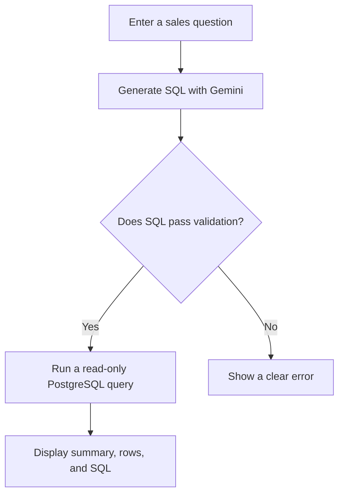

# How the Business Data Query Assistant works

Text-to-SQL turns a plain-English question into a database query. Gemini gets a short description of the available sales columns so it can use the right table and fields.



Demo mode replaces the Gemini step with a lookup from the four example questions. The validator and PostgreSQL steps stay the same.

## Worked example

Ask **How many orders were placed in February 2025?** The query counts rows whose dates are on or after February 1 and before March 1. Using an exclusive end date also works for dates with times in a database schema that stores timestamps. The demo returns **4**.

```sql
SELECT count(*) AS order_count
FROM reporting.sales
WHERE order_date >= '2025-02-01'
  AND order_date < '2025-03-01'
LIMIT 101;
```

The SQL parser builds a tree describing the statement. The app allows only supported nodes, forces a maximum SQL limit, and executes the checked copy. It fetches one extra row to tell the interface when the result was cut off.

## Why PostgreSQL has a dedicated reader

| Safeguard | Role |
| --- | --- |
| Schema prompt | Describes one known view and the meaning of its fields. |
| SQL validator | Rejects unsupported statement types, sources, functions, and structure before execution. |
| Reporting view and login | Limit access to the columns and rows an administrator approved. |
| Read-only transaction | Adds a database-level restriction for each request. |
| Row limit and statement timeout | Bound how much comes back and how long a statement runs. |

Python builds the plain-language summary from returned rows, keeping result rows out of Gemini requests. The query can be structurally valid and still answer the wrong question. Check filters, date ranges, and grouping before relying on the answer.
